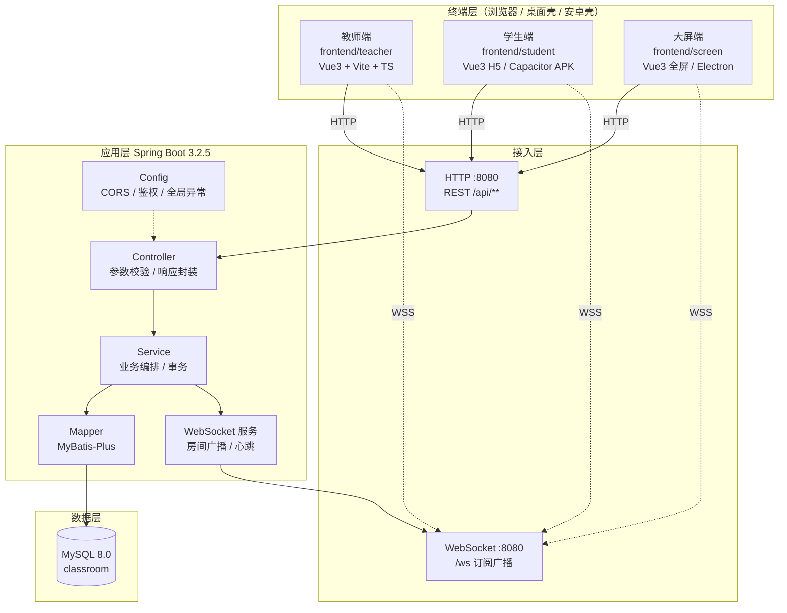
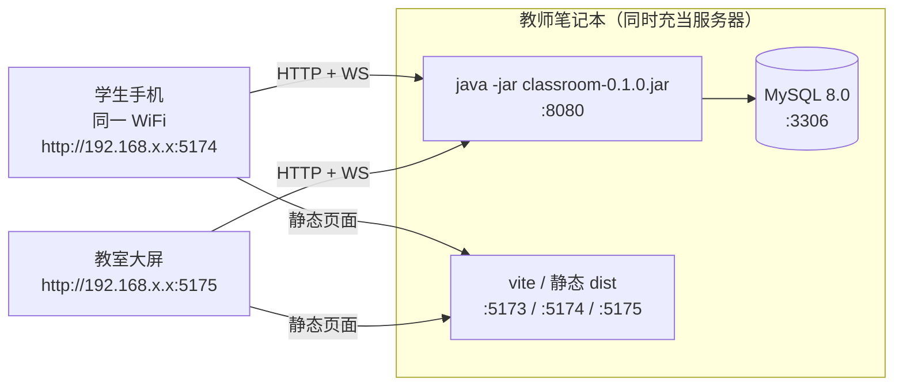
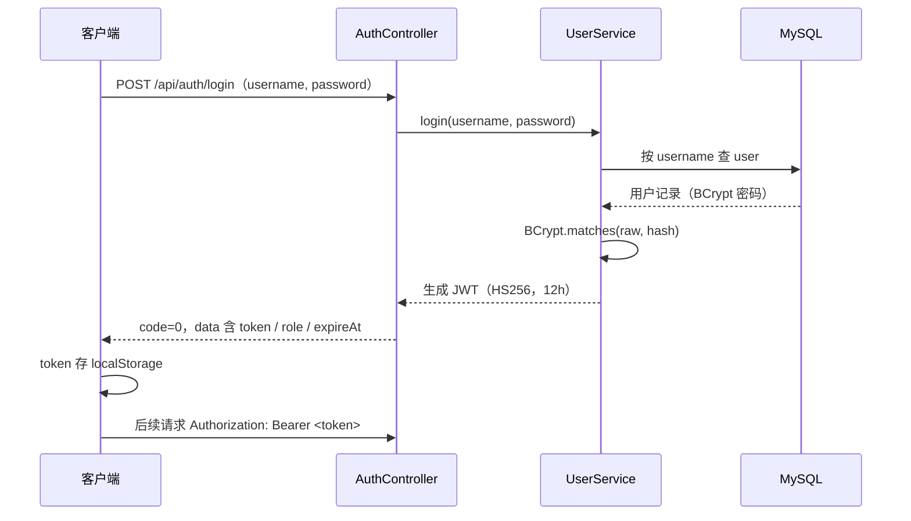
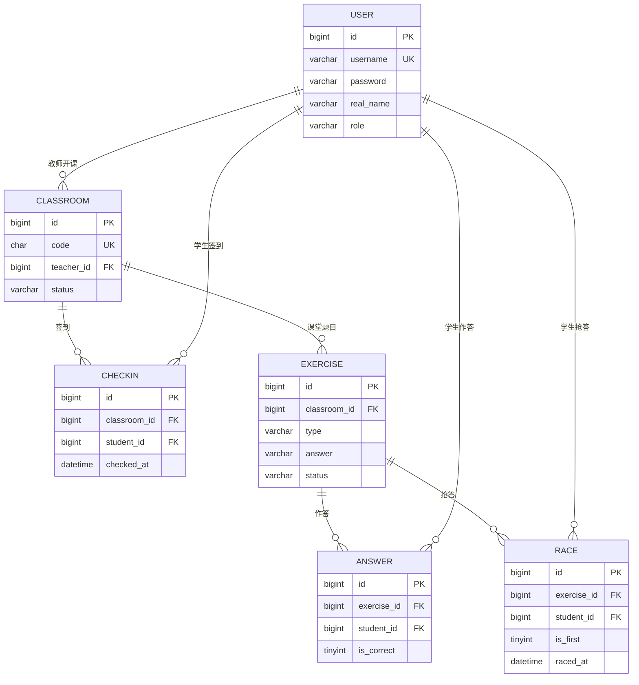
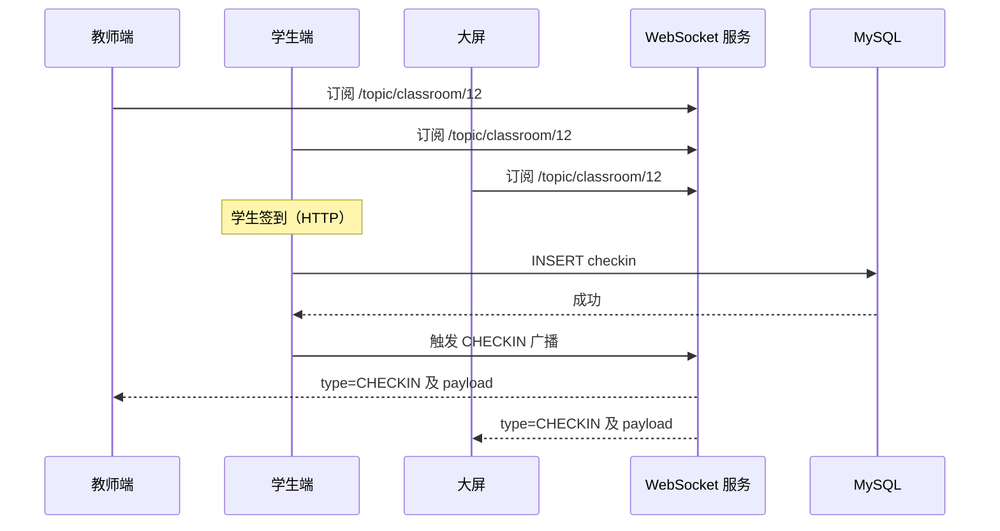
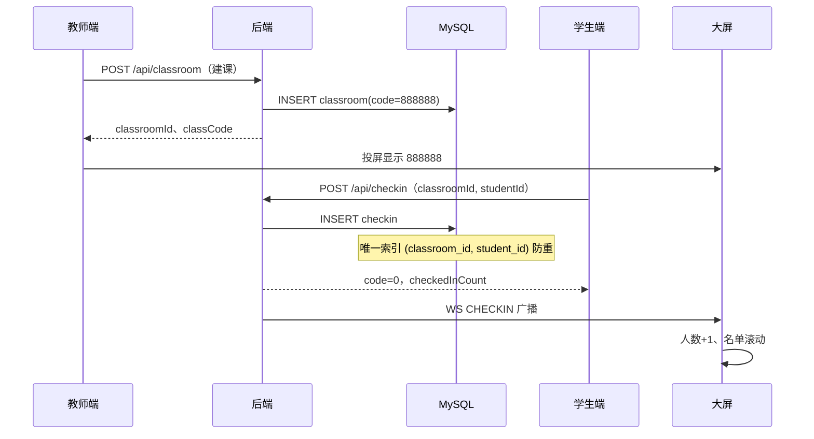
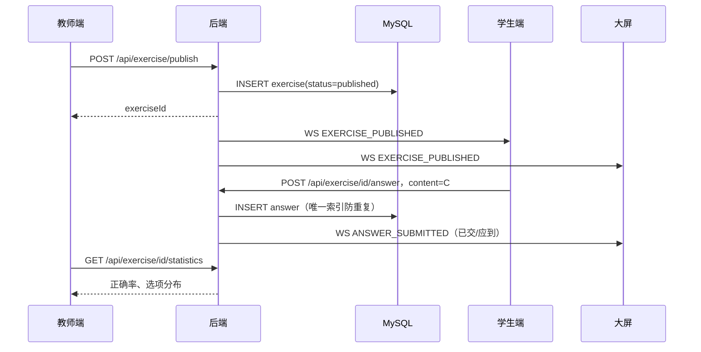
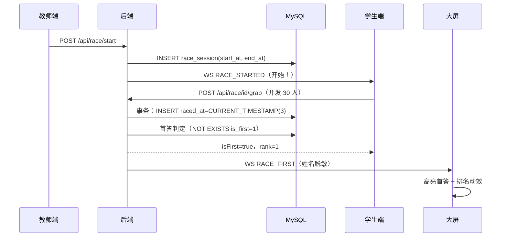

# 系统设计文档（SAD）

| 项 | 内容 |
| :--- | :--- |
| 文档编号 | docs/05 |
| 版本 | v1.0（初始化版） |
| 编写人 | PM（技术负责人） |
| 评审人 | M1~M5 全体 |
| 关联文档 | `docs/01-产品需求文档(PRD).md`、`docs/04-接口契约模板.md`、`docs/02-五周排期与详细分工.md` |
| 适用代码 | 仓库 `main` 分支初始骨架（commit `31d4e17`） |
| 状态 | 基线版；任何架构级变更须提 PR 并在此文档追加版本记录 |

> 本文档回答四个问题：**系统长什么样（架构）**、**数据怎么存（库表）**、**各端怎么协作（时序与实时通道）**、**为什么这么设计（决策与取舍）**。
> 需求"做什么"见 `docs/01`，接口字段"传什么"见 `docs/04`，本文不重复抄写，只补齐**设计与实现约束**。

---

## 1. 设计目标与约束

### 1.1 目标

| 编号 | 目标 | 可验证指标 |
| :--- | :--- | :--- |
| G1 | 局域网内零外网可用 | 断开公网后，建课/签到/答题/抢答/大屏全流程可用 |
| G2 | 单课堂 60 人稳定 | 签到接口 P95 < 300ms；30 人并发抢答只有 1 条首答 |
| G3 | 教师零培训可用 | 建课到投屏 ≤ 3 次点击；错误提示为中文人话 |
| G4 | 数据可沉淀 | 每节课的签到、作答、抢答全部落库，可导出 Excel |
| G5 | 6 人可并行开发 | 目录物理隔离，单人改动不触碰他人文件 |
| G6 | 本地原生部署 | 只用 JDK 17 / MySQL 8 / Node 20，不引入 Docker、Redis、Nginx 等额外中间件 |

### 1.2 约束

- **不使用 Docker**：教室电脑由学生自带，装不了 Docker Desktop（Windows 家庭版无 Hyper-V）。
- **不引入 Redis / MQ**：MySQL 足够承担单课堂量级；消息广播走进程内 WebSocket，避免运维成本。
- **不做多租户**：一个后端实例服务一间教室；跨教室并发不在本期范围。
- **学生免注册**：避免课堂现场注册流失，靠"学号+姓名+课堂码"识别。

### 1.3 设计原则

1. **先跑通闭环，再谈优雅**：P0 链路优先，P1 功能允许降级。
2. **契约先行**：接口字段先定稿（docs/04），前后端并行开发。
3. **数据库兜底正确性**：防重复、判首答等关键约束放在数据库唯一索引/时间戳，而非仅靠应用层判断。
4. **失败要可诊断**：统一错误码 + 后端日志含 traceId（后续扩展）+ 前端可读提示。
5. **默认安全**：密码 BCrypt、Token 鉴权、姓名脱敏、配置不落库。

---

## 2. 总体架构

### 2.1 逻辑架构



**分层职责**

| 层 | 职责 | 禁止事项 |
| :--- | :--- | :--- |
| Controller | 接参、校验、调用 Service、封装响应 | 写 SQL、写业务分支 |
| Service | 业务规则、事务边界、调用 WebSocket 推送 | 直接操作 HttpServletRequest |
| Mapper | 单表 / 联表查询 | 写业务判断 |
| Entity / DTO | 数据载体 | 承载业务方法 |
| WebSocket | 订阅管理、广播、心跳 | 直接查库（应调 Service） |

### 2.2 部署拓扑（局域网原生环境）



**端口约定**

| 服务 | 端口 | 说明 |
| :--- | :--- | :--- |
| 后端 API / WS | 8080 | 单端口同时承载 HTTP 与 WebSocket |
| 教师端 dev | 5173 | Vite 默认 |
| 学生端 dev | 5174 | `vite --port 5174` |
| 大屏端 dev | 5175 | `vite --port 5175` |
| MySQL | 3306 | 本地实例 |

> 联调时三端都指向**同一 IP**（教师笔记本的局域网 IPv4），前端通过 `vite.config.ts` 的 proxy 转发 `/api`、`/ws`，避免跨域与硬编码 IP。

### 2.3 技术选型与理由

| 层 | 选型 | 版本 | 选择理由 | 被否方案 |
| :--- | :--- | :--- | :--- | :--- |
| 后端框架 | Spring Boot | 3.2.5 | 生态成熟、组员课程已学、内嵌 Tomcat 免部署 | Quarkus（资料少）、Node（组员不熟） |
| JDK | 17 LTS | 17.0.x | Boot 3 最低要求，长期支持 | 8（不支持 Boot3）、21（组员环境未普及） |
| ORM | MyBatis-Plus | 3.5.7（boot3 starter） | 单表 CRUD 免手写 SQL，复杂统计仍可写 XML | JPA（复杂统计不直观） |
| 数据库 | MySQL | 8.0 | 课程统一、支持 JSON 字段存选项、窗口函数做排行 | SQLite（并发弱）、PostgreSQL（组员环境无） |
| 接口文档 | springdoc-openapi | 2.5.0 | 与 Boot 3 兼容，Swagger UI 开箱即用 | 手工维护 api.yaml（易过期） |
| 实时 | Spring WebSocket | 随 Boot | 无额外中间件、原生 STOMP 即可满足广播 | Socket.IO（需 Node 网关）、MQTT（过重） |
| 前端 | Vue 3 + Vite + TS | 3.4 / 5.2 / 5.4 | 组合式 API 上手快，Vite 冷启动秒级 | React（组员熟悉度低） |
| 桌面壳 | Electron | 第 3 周引入 | 前端零改造打 exe，图标/全屏可控 | Tauri（需 Rust 环境） |
| 安卓壳 | Capacitor | 第 3 周引入 | H5 直接打包 APK，无需 Android 原生开发 | 原生 Android（工期不够） |
| 压测 | JMeter / k6 | 第 5 周 | 30 人并发脚本简单 | 自研脚本（时间成本高） |

---

## 3. 后端设计

### 3.1 工程结构

```text
backend/
├─ pom.xml                          # Boot 3.2.5 parent + 依赖
└─ src/main/
   ├─ java/com/classroom/
   │  ├─ ClassroomApplication.java  # 启动类（@MapperScan("com.classroom.mapper")）
   │  ├─ controller/                # AuthController / ClassroomController / CheckinController
   │  │                             # ExerciseController / RaceController
   │  ├─ service/                   # 业务接口 + impl（待 M3 填充）
   │  ├─ mapper/                    # MyBatis-Plus Mapper 接口（待 M3 填充）
   │  ├─ entity/                    # 与表一一对应的实体（待 M3 填充）
   │  ├─ config/                    # CorsConfig（已有）、后续 JwtConfig/WebSocketConfig
   │  ├─ utils/                     # 通用工具（待填充：Result、JwtUtil、MaskUtil）
   │  └─ websocket/                 # M4 领地：握手、会话管理、广播
   └─ resources/
      ├─ application.yml            # 端口/数据源/hikari/springdoc/mybatis-plus
      ├─ db/schema.sql              # 6 张表 DDL
      ├─ mapper/                    # MyBatis XML（复杂查询）
      ├─ static/ 、templates/        # 暂空
```

### 3.2 统一响应与异常

**响应体**（与 docs/04 §0.2 一致，全项目唯一格式）：

```json
{ "code": 0, "message": "success", "data": {} }
```

**约定**

- `code=0` 才代表成功；前端只判断 `code`，不解析 HTTP 状态码做业务分支（401/403 除外）。
- 业务异常统一抛 `BizException(code, message)`，由 `@RestControllerAdvice` 捕获并转成上述结构（待 M3 实现）。
- 未捕获异常返回 `code=500`，日志必须打印堆栈与请求路径，但**不向前端暴露堆栈**。

### 3.3 鉴权设计



| 设计点 | 方案 |
| :--- | :--- |
| Token 载体 | JWT，`HS256`，密钥来自环境变量 `JWT_SECRET`（不入库不入仓） |
| 有效期 | 12 小时（覆盖一次完整课程 + 余量） |
| 载荷 | `userId`、`role`、`classroomId`（学生）、`exp` |
| 校验位置 | 拦截器 / Filter，白名单：`/api/auth/**`、`/api/classroom/{id}/overview`（大屏只读）、`/v3/api-docs/**`、`/swagger-ui/**` |
| 角色隔离 | 学生 Token 禁止访问教师接口（`/api/classroom`、`/exercise/publish`、`/race/start`） |
| 学生免注册 | 首次 `student-join` 自动 `INSERT user(role=student)`，密码字段留空 |

### 3.4 跨域与代理

- 后端 `CorsConfig`：`addMapping("/**")` + `allowedOriginPatterns("*")` + `allowCredentials(true)`。
  **为什么不用 `allowedOrigins("*")`**：Spring 规范下 `*` 与 credentials 互斥，会直接抛 `IllegalArgumentException`。
- 前端 `vite.config.ts` 代理 `/api`、`/ws` 到 `http://localhost:8080`，使浏览器同源，生产打包后同样可用（Electron 内置加载 dist 时走同一代理逻辑或直连 API base）。
- 局域网真机：改代理 target 为 `http://192.168.x.x:8080`，或统一用相对路径 + 页面同源部署。

### 3.5 配置与环境变量

| 配置项 | 默认 | 来源 | 说明 |
| :--- | :--- | :--- | :--- |
| `server.port` | 8080 | 固定 | WebSocket 复用 |
| `spring.datasource.url` | `jdbc:mysql://localhost:3306/classroom?...` | 固定 | `utf8mb4`、东八区、`allowPublicKeyRetrieval` |
| `spring.datasource.username` | `${DB_USERNAME:root}` | 环境变量 | 占位默认值 |
| `spring.datasource.password` | `${DB_PASSWORD:123456}` | 环境变量 | **真实密码走 `application-local.yml`（已 gitignore）或环境变量** |
| `...hikari.initialization-fail-timeout` | `-1` | 固定 | 允许"先起后端、后起 MySQL" |
| `springdoc.swagger-ui.path` | `/swagger-ui.html` | 固定 | 组员自测入口 |

**无数据库也能启动的价值**：前端可先联调（拿到 500 或空数据），不被 MySQL 安装卡住；课堂现场 MySQL 未起时后端不至于"整个挂掉"，而只影响数据接口。

### 3.6 关键类职责

| 类 | 现状 | 目标职责 | 负责人 |
| :--- | :--- | :--- | :--- |
| `ClassroomApplication` | 已实现 | 启动 + Mapper 扫描 | M3 |
| `CorsConfig` | 已实现 | 全局跨域 | M3 |
| `AuthController` | 占位（`/ping`、`/login`） | 登录、学生进课堂、刷新 Token | M3 |
| `ClassroomController` | 占位 | 建课（生成 6 位码）、结束课堂、选人 | M3 |
| `CheckinController` | 占位 | 签到、名单、关闭窗口 | M3 |
| `ExerciseController` | 占位 | 发题、交卷、统计 | M3 |
| `RaceController` | 占位 | 发起抢答、抢答、排名 | M3 |
| `websocket/*` | 空包（`.gitkeep`） | 握手、会话、广播、心跳 | **M4** |

---

## 4. 数据库设计

### 4.1 ER 图



### 4.2 表设计要点

> 完整 DDL 见 `backend/src/main/resources/db/schema.sql`，此处只说明**设计意图**。

| 表 | 核心字段 | 关键约束 | 设计意图 |
| :--- | :--- | :--- | :--- |
| `user` | `username` UK、`role`、`student_no` | `uk_user_username` | 教师与学生共表，靠 `role` 区分，减少一张表与联表成本 |
| `classroom` | `code` CHAR(6) UK、`status`、`checkin_open` | `uk_classroom_code` | 6 位码即对外入口；`checkin_open` 用一列控制签到窗口，避免额外状态表 |
| `checkin` | `classroom_id`+`student_id` UK | `uk_checkin_class_student` | **数据库层面兜底防重复签到**，并发下也不会写出两条 |
| `exercise` | `type`、`options` JSON、`answer`、`status` | — | 选项存 JSON，前后端直接透传，免建 `option` 表；`status` 控制"发布/截止" |
| `answer` | `exercise_id`+`student_id` UK、`is_correct` | `uk_answer_exercise_student` | 一题一人一条，重复提交由唯一索引拦截 |
| `race` | `is_first`、`raced_at` DATETIME(3) | `uk_race_exercise_student` | **毫秒精度时间戳**判定首答；`is_first=1` 由应用层"先查后插 + 事务"保证唯一 |

### 4.3 并发正确性设计（重点）

**问题 1：重复签到 / 重复交卷**

应用层"先查再插"在并发下会双写。设计为**双保险**：

1. 先 `SELECT` 快速返回友好提示；
2. 唯一索引兜底，捕获 `DuplicateKeyException` 转成业务码 `1003 / 2001`。

**问题 2：抢答"谁第一"**

禁止使用客户端时间（可篡改、时钟不准）。设计为：

```sql
-- 插入时由数据库生成毫秒时间戳，事务内判定
START TRANSACTION;
INSERT INTO race(exercise_id, student_id, raced_at)
VALUES (?, ?, CURRENT_TIMESTAMP(3));
-- 若该题尚无 is_first=1，则把本次置为首答
UPDATE race SET is_first = 1
 WHERE exercise_id = ? AND NOT EXISTS (
   SELECT 1 FROM (SELECT id FROM race WHERE exercise_id = ? AND is_first = 1) t
 );
COMMIT;
```

| 方案 | 是否采用 | 原因 |
| :--- | :--- | :--- |
| 客户端时间戳排序 | ❌ | 可篡改、设备时钟差异 |
| 应用服务器时间 | ⚠️ 备选 | 单实例可用，多实例时钟漂移 |
| **数据库 `CURRENT_TIMESTAMP(3)` + 唯一首答** | ✅ | 单一时间源，天然串行化 |
| 分布式锁 / Redis INCR | ❌ | 违反"不引入中间件"约束 |

> 兜底：`race` 表加 `UNIQUE(exercise_id, is_first)` 不可行（0 值会冲突），因此首答唯一性由"事务 + `NOT EXISTS` 子查询"保证，压测用例必须覆盖"30 人并发只有 1 条 `is_first=1`"。

### 4.4 索引设计

| 索引 | 表 | 支撑查询 |
| :--- | :--- | :--- |
| `uk_classroom_code` | classroom | 学生按 6 位码进课堂（最高频读） |
| `idx_checkin_student` | checkin | 学生个人学情报告 |
| `idx_answer_student` | answer | 排行榜、个人错题 |
| `idx_race_exercise_time` | race | 抢答排名按时间排序 |
| `idx_exercise_classroom` | exercise | 课堂题目列表 |

**约定**：所有查询必须命中索引或走主键；新增 SQL 需在 PR 中说明执行计划（`EXPLAIN`），禁止 `SELECT *` 全表扫描用于大屏轮询。

---

## 5. 实时通信设计（M4）

### 5.1 通道模型

- 单端点 `/ws`，STOMP over WebSocket（`SockJS` 兜底可选）。
- **按课堂分房间**：订阅路径 `/topic/classroom/{classroomId}`，广播只发给该课堂的会话，避免跨课串台。
- 客户端上行：`/app/classroom/{classroomId}/...`（如需学生主动发弹幕）；服务端主动推送走 `/topic/...`。



### 5.2 消息协议

```json
{ "type": "CHECKIN", "timestamp": 1735689600000, "payload": { } }
```

| type | 方向 | 触发 | payload |
| :--- | :--- | :--- | :--- |
| `CHECKIN` | 服务端→全房间 | 学生签到成功 | `studentId`、`realName`（脱敏）、`checkedInCount` |
| `EXERCISE_PUBLISHED` | 服务端→全房间 | 教师发题 | `exerciseId`、`type`、`stem`、`options`、`durationSeconds` |
| `ANSWER_SUBMITTED` | 服务端→教师/大屏 | 学生交卷 | `exerciseId`、`submittedCount`、`totalStudents` |
| `RACE_STARTED` | 服务端→全房间 | 教师发起抢答 | `raceId`、`endAt` |
| `RACE_FIRST` | 服务端→全房间 | 首个抢答成功 | `studentId`、`realName`、`racedAt` |
| `DANMU`（P1） | 服务端→全房间 | 学生发弹幕 | `studentId`、`content` |
| `CLASS_CLOSED` | 服务端→全房间 | 结束课堂 | `classroomId` |

**约定**：消息只做"通知"，不作为数据真相。前端收到消息后如需完整数据，应再拉一次 HTTP 接口（**避免消息丢包导致状态错误**）。

### 5.3 可靠性设计

| 问题 | 设计 |
| :--- | :--- |
| 断线重连 | 前端指数退避重连（1s→2s→4s，上限 10s），重连成功先拉 `overview` 对齐状态 |
| 消息丢失 | 消息仅作提示；关键状态以 HTTP 查询为准（见 5.2 约定） |
| 心跳 | 服务端 25s 心跳，客户端 30s 无消息主动重连 |
| 会话泄漏 | 连接关闭时移除会话；广播时过滤已关闭会话 |
| 广播性能 | 单课堂会话数 ≤ 60，直接遍历发送；不做线程池异步（避免乱序） |

---

## 6. 前端设计

### 6.1 三端职责

| 端 | 目录 | 端口 | 使用者 | 关键页面 | 负责人 |
| :--- | :--- | :--- | :--- | :--- | :--- |
| 教师端 | `frontend/teacher` | 5173 | 教师笔记本 | 登录、我的课堂、签到管理、随堂练习、抢答控制、学情报告 | M2 |
| 学生端 | `frontend/student` | 5174 | 学生手机 | 输码进课、签到、答题、抢答、个人报告 | M1 |
| 大屏端 | `frontend/screen` | 5175 | 教室投影 | 课堂码、签到墙、题目与柱状图、抢答首答、数据看板 | M5 |

### 6.2 教师端结构（已落地）

```text
frontend/teacher/
├─ index.html
├─ package.json              # vue / vue-router / vite / @vitejs/plugin-vue / typescript / vue-tsc
├─ tsconfig.json             # strict + bundler 解析
├─ tsconfig.node.json        # 供编辑器识别 vite.config.ts
├─ vite.config.ts            # 代理 /api、/ws、/v3/api-docs → 8080
└─ src/
   ├─ main.ts                # createApp(App).use(router).mount('#app')
   ├─ App.vue                # 布局壳（含“教师端初始化成功”）
   ├─ env.d.ts               # vite/client 与 *.vue 类型声明
   ├─ styles/base.css        # CSS 变量与基础重置
   ├─ router/index.ts        # 6 条路由（/ → Login，含 404 重定向）
   └─ views/                 # Login / Classroom / Checkin / Exercise / Race（当前为“页面占位”）
```

**路由设计**

| 路径 | 组件 | 说明 |
| :--- | :--- | :--- |
| `/` | `Login.vue` | 默认落地页 |
| `/classroom` | `Classroom.vue` | 建课、课堂码、结束课堂 |
| `/checkin` | `Checkin.vue` | 签到名单与实时人数 |
| `/exercise` | `Exercise.vue` | 发题、答题进度、正确率 |
| `/race` | `Race.vue` | 发起抢答、倒计时、排名 |
| `/:pathMatch(.*)*` | — | 重定向到 `/` |

**约定**

- 懒加载所有视图（`() => import(...)`），保证首屏体积可控。
- 组件内 `<script setup lang="ts">`，禁止 `any` 滥用；接口返回类型放 `src/types/`（M2 后续新增）。
- 状态管理本期不引入 Pinia：跨页共享仅"当前课堂"与"Token"，用 `provide/inject` 或 `localStorage` 足够；若引入需在本文档登记 ADR。

### 6.3 大屏端设计（M5）

| 设计要求 | 理由 |
| :--- | :--- |
| 课堂码字号 ≥ 200px、居中 | 教室最后一排 10 米可辨识 |
| 姓名脱敏（张*明） | 投影公开可见，避免隐私泄露 |
| 数据刷新 ≤ 3s 或 WebSocket 实时 | 课堂节奏紧凑，滞后会冷场 |
| 1920×1080 与 4K 自适应（`rem`/`vw`） | 不同教室设备分辨率差异大 |
| 断网降级：显示"网络异常，正在重连" | 避免大屏空白引发尴尬 |

### 6.4 桌面/安卓套壳（第 3 周）

| 端 | 方案 | 要点 |
| :--- | :--- | :--- |
| 教师端 | Electron 打包 exe | 图标 `app.ico`、禁用菜单栏、窗口最小尺寸、`loadFile(dist/index.html)` |
| 大屏端 | Electron 全屏 | `fullscreen: true`、`kiosk` 可选、禁止 Esc 退出（可选） |
| 学生端 | Capacitor 打 APK | `server.url` 指向局域网后端时需允许明文 HTTP（`android:usesCleartextTraffic="true"`） |

---

## 7. 关键流程时序

### 7.1 签到闭环



### 7.2 发题与作答



### 7.3 抢答判定



---

## 8. 安全设计

| 风险 | 设计 | 状态 |
| :--- | :--- | :--- |
| 密码泄露 | BCrypt 加盐哈希，禁止明文/可逆加密 | 待 M3 实现 |
| Token 泄露 | HTTPS（课堂内网可选）、Token 12h 过期、localStorage 存储（XSS 前提下） | 待实现 |
| SQL 注入 | MyBatis `#{}` 参数化，禁止 `${}` 拼接用户输入 | 规范约束 |
| 越权 | 拦截器校验 `role` + 资源归属（教师只能管自己的课堂） | 待实现 |
| 隐私 | 大屏姓名脱敏；日志不打印密码与 Token | 规范约束 |
| 配置泄露 | `application-local.yml`、`.env` 已 gitignore；真实密码不入库 | 已落地 |
| 刷接口 | 弹幕 3s/条、签到按唯一索引、抢答按唯一索引 | 待实现 |
| 跨域 | `allowedOriginPatterns("*")` + credentials（内网可接受，公网需收敛白名单） | 已落地 |

**明确不做（本期）**：HTTPS 证书、WAF、审计日志、验证码、多因素认证。

---

## 9. 性能设计与压测

| 指标 | 目标 | 设计手段 |
| :--- | :--- | :--- |
| 签到 P95 | < 300ms | 单条 INSERT + 唯一索引；无跨表事务 |
| 抢答判定 | < 100ms | 单事务 2 条 SQL；`raced_at` 索引 |
| 大屏刷新 | ≤ 3s | WebSocket 推送 + HTTP 轮询兜底（3s） |
| 单课堂并发 | 60 人 | 连接池 `maximum-pool-size=10`（读写分离前足够） |
| 压测规模 | 30 并发 | JMeter 线程组 30，持续 60s，统计 TPS/错误率/P99 |

**压测验收**：30 并发抢答时 `SELECT COUNT(*) FROM race WHERE exercise_id=? AND is_first=1` 必须等于 1；签到无重复行；错误率 0。

**已知瓶颈**：Hikari 连接池 10 连接、单实例 Tomcat 默认 200 线程，超过 200 并发需调 `server.tomcat.threads.max` 与连接池；本期不优化（课堂规模 60 人）。

---

## 10. 可观测性与排障

| 手段 | 设计 |
| :--- | :--- |
| 日志 | Logback 控制台输出，格式 `时间 级别 [线程] logger - msg`；`com.classroom` 为 DEBUG |
| 请求日志 | 由 M3 增加 `@RestControllerAdvice` 记录异常；正常请求可选 `CommonsRequestLoggingFilter` |
| Swagger | `/swagger-ui.html` 在线自测，联调期作为"接口是否活着"的探针 |
| 健康检查 | `GET /api/auth/ping` 返回 `{"code":0,"message":"pong"}`，前端代理连通性自测 |
| 数据库诊断 | 启动失败先看 `Communications link failure`；无库启动属预期（见 3.5） |

---

## 11. 打包与交付设计

| 产物 | 命令 | 输出 | 说明 |
| :--- | :--- | :--- | :--- |
| 后端 jar | `mvn -DskipTests package` | `backend/target/classroom-0.1.0.jar` | 内嵌 Tomcat，`java -jar` 直接跑 |
| 教师端静态包 | `npm run build` | `frontend/teacher/dist/` | 可被 Electron 加载 |
| 教师端 exe | electron-builder | `frontend/teacher/release/*.exe` | 第 3 周 |
| 学生端 APK | Capacitor + Android Studio | `*.apk` | 第 3 周 |
| 大屏 exe | electron-builder | `*.exe`（全屏） | 第 3 周 |

**交付清单（第 5 周）**：jar + 三端安装包 + 数据库脚本 + 演示视频 + 答辩 PPT + 测试报告。

---

## 12. 设计决策记录（ADR）

| 编号 | 决策 | 背景 | 结论 | 代价 |
| :--- | :--- | :--- | :--- | :--- |
| ADR-01 | 不用 Docker | 教室电脑无虚拟化 | 原生 JDK/MySQL/Node | 环境不一致风险，靠 README 版本表约束 |
| ADR-02 | 不引入 Redis | 单课堂量级小 | 进程内 WebSocket + MySQL | 无法水平扩展，接受 |
| ADR-03 | 6 位数字课堂码 | 学生输入成本 | 全局唯一，同一时刻仅一个进行中 | 需回收/置空机制 |
| ADR-04 | 选项存 JSON | 选项数固定 4 个 | `exercise.options` JSON 列 | 无法按选项建索引（无此需求） |
| ADR-05 | 首答用 DB 时间戳 | 公平性是答辩亮点 | `CURRENT_TIMESTAMP(3)` + 事务判首答 | SQL 略复杂，需压测验证 |
| ADR-06 | 学生免注册 | 现场注册必流失 | 学号+姓名+课堂码自动建档 | 存在冒名签到风险，接受（课堂场景） |
| ADR-07 | 三端独立工程 | 三人并行开发 | 三个 Vite 工程，各自端口 | 公共组件需复制，接受 |
| ADR-08 | 前端不引入 UI 库 | 减少依赖与体积 | 手写少量样式 + CSS 变量 | UI 打磨成本高 |

---

## 13. 风险与演进

| 风险 | 影响 | 缓解 |
| :--- | :--- | :--- |
| MySQL 未装/未启动 | 接口 500 | `initialization-fail-timeout=-1` 先起后连；README 第 1 步强制建库 |
| 局域网 IP 变化 | 手机连不上 | 联调用相对路径 + 代理；文档写明如何改 target |
| 并发判首答错误 | 答辩演示翻车 | 唯一索引 + 压测用例固化（30 并发） |
| 组员环境版本不一 | "我这能跑" | README 版本表 + 周五环境检查 |
| 大屏数据未脱敏 | 隐私投诉 | 代码评审检查 + 测试报告专项 |

**演进方向（本期不做）**：多实例部署（需 Redis 广播）、WebSocket 集群、题库导入模板、HTTPS、家长端。

---

## 14. 文档与代码映射

| 设计内容 | 落地文件 |
| :--- | :--- |
| 架构分层 | `backend/src/main/java/com/classroom/**` |
| 统一响应/异常 | `backend/.../utils/`（待 M3）、Controller 占位方法 |
| 跨域 | `backend/.../config/CorsConfig.java` |
| 数据源与端口 | `backend/src/main/resources/application.yml` |
| 表结构 | `backend/src/main/resources/db/schema.sql` |
| 教师端路由与代理 | `frontend/teacher/src/router/index.ts`、`vite.config.ts` |
| 实时通道 | `backend/.../websocket/`（M4） |
| 接口字段 | `docs/04-接口契约模板.md` |
| 需求与优先级 | `docs/01-产品需求文档(PRD).md` |
| 排期与分工 | `docs/02-五周排期与详细分工.md` |

---

## 15. 版本记录

| 版本 | 日期 | 修改人 | 说明 |
| :--- | :--- | :--- | :--- |
| v1.0 | 第 1 周 | PM | 初始化：架构、库表、实时通道、时序、安全、ADR |
